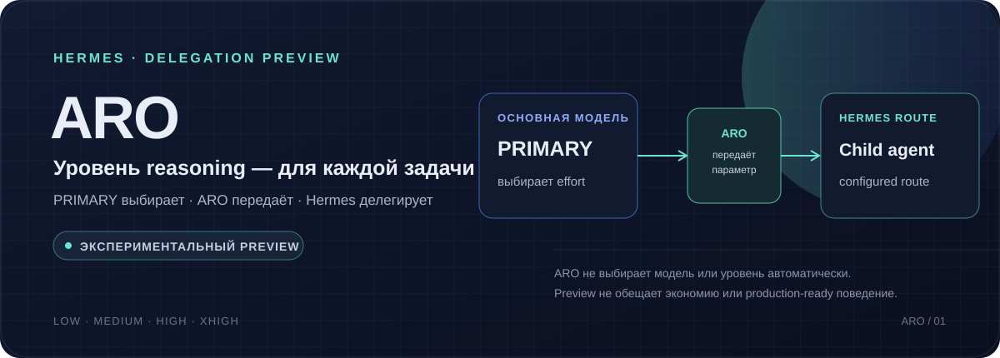
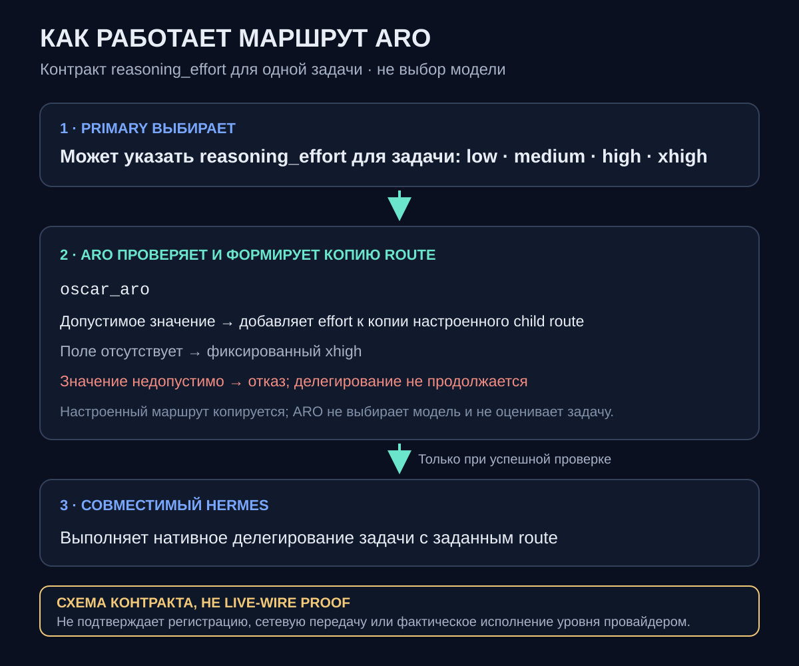
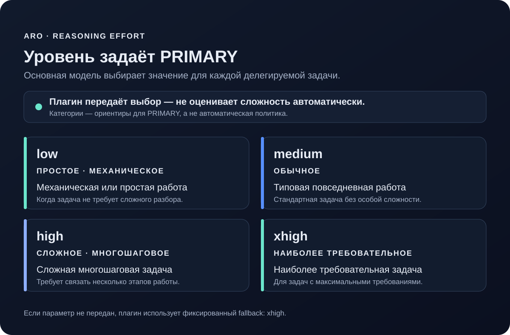
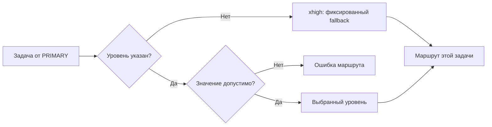

# ARO — выбор уровня reasoning для задач Hermes delegation

**Экспериментальный публичный snapshot · manifest плагина `1.0.1` · предварительный тег `v1.0.1-preview.1`**

ARO — небольшой backend-плагин для нативного механизма делегирования Hermes. Он добавляет к каждой задаче `delegate_task` параметр `reasoning_effort`, чтобы основная модель Hermes могла назначить конкретному дочернему агенту один из поддерживаемых уровней: `low`, `medium`, `high` или `xhigh`.

> ARO не выбирает модель и не оценивает задачу автоматически. Уровень для каждой задачи выбирает PRIMARY — основная модель, которая уже понимает задачу и управляет делегированием. Если параметр не передан, плагин использует фиксированный fallback `xhigh`.

## Как проходит делегирование



PRIMARY может указать уровень для конкретной задачи. ARO проверяет его и добавляет в настроенный маршрут дочернего агента; дальше используется нативное делегирование Hermes. Схема показывает назначение компонентов, а не гарантию совместимости или подтверждение live-wire: её нужно проверять для конкретной установки.

## Уровни reasoning



Примеры на схеме — ориентиры, а не автоматическая политика: `low` — простая или механическая работа, `medium` — типовая, `high` — сложная многошаговая, `xhigh` — наиболее требовательная. Плагин не анализирует текст, не ранжирует сложность и не переключает уровень сам.

### Как обрабатывается параметр



Допустимые значения: `low`, `medium`, `high`, `xhigh`. Диаграмма описывает проверку параметра; конфигурация маршрута также должна быть допустимой.

## Что делает этот snapshot

- Регистрирует backend с именем `oscar_aro` через `ctx.register_delegation_provider(...)`.
- Объявляет параметр задачи `reasoning_effort` с enum `low`, `medium`, `high`, `xhigh`.
- Передаёт выбранный уровень в route именно этой задачи; некорректное значение отклоняется.
- Сохраняет существующий маршрут дочернего агента: модель, provider, endpoint, режим API, overrides и fallback providers копируются из конфигурации delegation, если они заданы.
- Не меняет общий маршрут для других задач и не запускает собственную систему планирования, исполнителей или координации.
- Использует `service_tier=normal` в route. Hermes проверяет совместимость service tier для фактически выбранного child route; в иных конфигурациях этот параметр может ограничить совместимость. Здесь не заявляется конкретное поведение провайдера за пределами подтверждённого Hermes route.

## Условия и интеграция

Плагин предназначен только для **совместимого нативного delegation-provider seam Hermes**. Это не универсальный адаптер для произвольных моделей, SDK, агентских фреймворков или произвольных версий Hermes.

Перед включением проверьте всё перечисленное:

1. В целевой установке Hermes есть публичный интерфейс `DelegationProvider` и регистрация `PluginContext.register_delegation_provider`.
2. Установленный Hermes вызывает `task_parameters()` и `route_task()` для задач нативного `delegate_task` и прокидывает `reasoning_effort` через route к child.
3. Выбранные provider и model должны принимать используемые значения `reasoning_effort` (в частности, `xhigh`); наличие значения в schema плагина само по себе не гарантирует поддержки в downstream-маршруте.
4. Проверьте discovery-path и формат пользовательских плагинов именно своей версии Hermes. Текущая официальная документация показывает пользовательский каталог `~/.hermes/plugins/<plugin-directory>/` и отдельный способ регистрации delegation provider через `register_delegation_provider`; не считайте содержимое релизной папки уже установленным. Разместите `plugin/oscar-aro-effort/` по правилам discovery вашей установки и проверьте manifest.
5. Пользовательский plugin нужно включить через документированный интерфейс (`plugins.enabled`/plugin manager) согласно вашей версии Hermes; само наличие каталога не означает, что код загружен. Затем выберите `delegation.backend: oscar_aro`. Блок `delegation.backends.oscar_aro` должен быть пустым или отсутствовать: эта реализация не принимает backend-specific настройки. Существующий маршрут задавайте обычными ключами `delegation`.
6. Если в `delegation` задан `reasoning_effort`, он должен быть `xhigh`: реализация отказывает при любом другом значении, сохраняя фиксированный `xhigh` fallback для задачи без параметра. Для per-task назначения PRIMARY должен передавать параметр в конкретный вызов.
7. Выберите backend до тестирования в новой или явно перестроенной сессии; не рассчитывайте, что уже выполняющиеся задачи будут изменены задним числом.
8. До использования на рабочей сессии проведите тест в изолированном профиле и подтвердите в вашей версии Hermes, что schema инструмента и фактически построенный child route содержат ожидаемый уровень и маршрут.

Мы **не публикуем универсальную install-команду или готовый конфиг**: подходящая раскладка и поведение зависят от версии и способа установки Hermes. Не копируйте плагин в рабочий профиль, пока не проверили документацию и фактический discovery-path вашей установки.

Справка Hermes: [Delegation Provider Plugins](https://hermes-agent.nousresearch.com/docs/developer-guide/delegation-provider-plugin), [Plugins](https://hermes-agent.nousresearch.com/docs/user-guide/features/plugins), [Configuration — Delegation](https://hermes-agent.nousresearch.com/docs/user-guide/configuration).

## Состав репозитория

- `plugin/oscar-aro-effort/` — исходники и manifest backend-плагина.
- `tests/` — автономные unit-тесты provider-контракта с заглушкой Hermes.
- `assets/` — визуализации и схема маршрута для README.
- `RELEASE_NOTES.md` — описание предварительного выпуска и его ограничений.

## Проверки и воспроизводимость

Из корня собранного snapshot с Python 3.10+ (только стандартная библиотека) запустите тесты provider-контракта:

```sh
python -m unittest discover -s tests -p 'test_*.py' -v
```

В этом snapshot команда выполнена успешно: 8 тестов. Тесты подставляют узкий in-process stub для Hermes-модуля `agent.delegation_provider` и проверяют поведение самого provider (уровни, fallback, некорректный ввод/конфигурацию, копирование route). Это **не** тест регистрации/dispatch с настоящим Hermes, не API/модельный вызов и не сетевой integration test.

Отдельный исторический отчёт offline route-isolation зафиксировал 7 тестов с mock transport. Это другая проверка и другое окружение, не CI данного snapshot. Синтетический SDK request не является live wire receipt.

Ограниченная живая проверка в отдельном испытании: два native child получили разные задания (`low` и `high`) и завершились ответами. Наблюдение было привязано к child и pre-SDK boundary; сериализованный live wire, провайдерский default tier и внутренний compute не подтверждены. Ни эти случаи, ни usage snapshot разных задач не доказывают качество, экономию, сокращение стоимости/токенов или квоты.

## Ограничения и риски

**Безопасность конфигурации:** `route_task` копирует заданные поля delegation route, в том числе `api_key`, если он присутствует в конфигурации. Считайте конфигурацию маршрута чувствительными данными: не публикуйте её, не добавляйте ключи в тесты и не выводите route целиком в логи. Как и обычные пользовательские плагины Hermes, это исполняемый Python-код; включайте его только если доверяете исходнику. Плагины не являются песочницей сами по себе.

- Это экспериментальный plugin snapshot, а не production-ready или универсально совместимый продукт.
- Без параметра на задаче действует `xhigh`; установка backend сама по себе не создаёт адаптивный выбор.
- Значение reasoning effort — подсказка маршруту Hermes/провайдера. Плагин не может гарантировать фактическое количество вычислений, качество или токенизацию у модели.
- Изменение или отключение плагина может повлиять на сессии, настроенные на backend `oscar_aro`; проверьте fallback/переключение на поддерживаемый backend согласно своей версии Hermes.
- Интеграция должна сохранять обычный нативный lifecycle Hermes. Плагин не заменяет worker framework и не вмешивается в планирование или принятие результатов PRIMARY.
